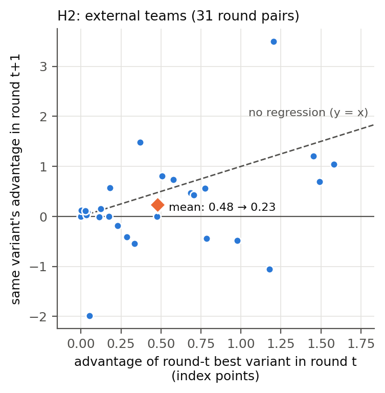

# What Is a Forecasting Leaderboard Rank Worth? Selection and Noise in ForecastBench's AI-versus-Superforecaster Comparison

**Juhong Park**, Massachusetts Institute of Technology · juhongp@mit.edu
*With Apart Research*

*Research conducted at the AI x Epistemics Research Sprint, November 2026.*

## Abstract

In July 2026 ForecastBench's maintainers concluded that AI forecasters have "likely reached parity" with superforecasters, while reporting that "17 submissions now rank above superforecasters" on a dataset-only preliminary board. We ask what such a rank is worth as evidence, replicating ForecastBench's scoring from public data (r = 0.997). A rank is weak evidence, largely because the human baseline is a single 2024 round, uncertain by ±1.8 points: in a calibrated model, a team 0.5 points better is only about twice as likely to rank above it as one 0.5 points worse, and a perfectly measured baseline would nearly double that ratio. The leading team's posterior odds of a real lead are about 1.5:1 to 5:1. Measured by question splits, selection matters less: the ordinary winner's curse costs the top entries about 0.7 points (exploratory; extrapolated), and a team's choice of its best entry within a round about 0.1 (pre-registered on half the questions, then extrapolated). But such splits miss luck shared by a whole round: on the board of 1 September, the round holding nine of the top ten kept a quarter of its lead over comparable rounds on later questions (exploratory). Easier recent rounds cannot be ruled out. Fresh superforecaster rounds would address the largest uncertainty; in simulation, held-out confirmation or a pre-declared primary entry, counted per team, cuts false outperformance claims at some cost in missed leads. The evidence does not establish an AI lead; the same audit could serve other AI-versus-human leaderboards.

## 1. Introduction

ForecastBench [1] is, by its maintainers' account, the only benchmark that compares AI forecasters with human superforecasters [2]. It poses questions about future events and scores forecasts against what happens. In July 2026 its maintainers wrote that "AI models have likely reached parity with superforecasters" and that the results "are more consistent with superforecaster parity than with outperformance", while reporting that "17 submissions now rank above superforecasters on our preliminary leaderboard" [2], a separate board scored only on resolved dataset questions. Earlier that month, Good Judgment's Warren Hatch had cautioned that, until humans and AI forecast the same questions at the same time, "strong claims about AI surpassing Superforecasters should be treated as interesting hypotheses, not established facts" [21]. Claims like these shape how much institutions trust AI judgement, and leaderboards that rank AI systems against one human baseline are increasingly read as such evidence. Yet how much evidence a rank above the human line carries is rarely measured: the human score is itself an estimate, and the top of any board is selected.

A leaderboard is also a selection device: when many noisy scores are ranked, the top over-represents lucky entries. This is the winner's curse [4] and the optimizer's curse [5]; in machine learning it appears as leaderboard overfitting [6, 7] and as inflated ranks for providers who test many private variants [9]. ForecastBench's tournament allows three forecast sets per team per round [18], and teams use the allowance in different ways: one entered two partisan-leaning copies of its main forecast "so we would not start at a disadvantage" [3]. We take up Track 1's question: *which exploits make benchmarks gameable, and can you demonstrate and close one?*

Figure 1 shows the 14 November 2026 board. Teams with six or more entries make up 17 of 63 external teams and 64% of external entries (188 of 295), yet they hold all seven entries strictly above the superforecaster median and 18 of the top 20 external entries. No entry is significantly better than superforecasters. Teams with more entries are also stronger on their median entry (Spearman 0.50), so the figure alone cannot separate selection from team strength.

![Figure 1. The top 20 external entries of the ForecastBench tournament leaderboard on 14 November 2026 and the superforecaster median, with published 95% confidence intervals. Colour shows how many entries the entry's team has on the board; the six-entry split was chosen after seeing the board. The dashed line and shaded band mark the superforecaster median and its published 95% CI. Team D's entry ties the published median at 68.1; the dotted line marks the replicated median (68.19) used in all analyses, below which Team D's entry falls. Teams are anonymised as Team A, B, ... in order of their best rank.](../figures/fig1_leaderboard_top20.png)

**Terms.** A *forecast set* is one submission to one two-week *round*. An *entry* is one named system on the board, scored over every round it entered; a team's *k* counts its entries on the board, which may span rounds. Scores are on ForecastBench's *Brier Index* (higher is better; 100 is perfect). A *held-out* score uses questions not used to pick the entry.

**Three questions and our answers.**

1. *Is a rank above the median strong evidence that AI beats superforecasters?* **No.** The superforecaster score is uncertain by ±1.8 points, so a single-round entry would need a true lead of 2.2 points to be detected half the time. With one entry, the baseline's error alone nearly halves the evidence a rank carries. For the leading team the data mildly favour a lead (posterior odds about 1.5:1 to 5:1) but allow anything from −0.70 to +2.65 points (90%).
2. *How much does selection inflate the top?* **About 0.7 points at the board's scale (extrapolated), mostly through the ordinary winner's curse; luck shared by a whole round can add more (exploratory).** Extrapolated from held-out splits, the ten best entries lose about 0.7 points relative to random entries (exploratory); a team's choice of its best entry within a round adds 0.18 points on half the questions (pre-registered), about 0.08 on all. Easier recent rounds cannot be ruled out.
3. *Do simple display policies help?* **Only as a trade-off.** In simulation, a held-out round or a pre-declared primary entry keeps false outperformance claims below the single-entry rate, even against deliberately divergent variants, but misses more real leads; it pays off once a false outperformance claim costs more than about one missed lead. For Track 1, the exploit is entering many variants; split across names, they defeat every per-name policy, and counting entries per team closes it.

The mechanism is textbook [4, 5, 6]. FRI [2] and Good Judgment [15, 21] stated the caveat, and Parallect [16] named the multiplicity problem; none measured how much evidence a rank carries, how much of that the human baseline costs, how large the selection gain is on held-out questions, or what display policies would do. We do, and define the first three as an audit that other AI-versus-human leaderboards could compute from their own data, with display policies tested in simulation that maintainers can adopt. We release an open replication of the scoring and a prospective registration of predictions for questions that resolve after our snapshot.

## 2. Related Work

Blum and Hardt [6] showed that repeated submissions can overfit a holdout leaderboard; Dwork et al. [7] gave tools for reusing a holdout set, and Recht et al. [8] attributed the accuracy drop on a fresh ImageNet test set to harder images rather than test-set reuse. Singh et al. [9] showed that private testing of many variants inflates Chatbot Arena ranks; Yang and Chen [10] measured how sensitive LLM leaderboard claims are to hidden model selection, and Zhang et al. [11] corrected the winner's curse in adaptive benchmarking. In simulated forecasting tournaments, the winner is often not among the most accurate forecasters [12], and incentive-compatible designs exist [13]. Paleka et al. [14] survey pitfalls in evaluating LLM forecasters, including ForecastBench. On ForecastBench itself, Good Judgment [15] found that four models above the superforecaster median on the preliminary, dataset-only board in March 2026 were "fleeting": by April only one remained above it; an AI-synthesized Parallect report [16] warned of "multiple comparisons inflation that can generate misleading parity headlines"; and Vaticinus Research [17] finds that frontier LLMs add little beyond the market price. ForecastBench's per-entry CIs and p-values [18] do not account for multiplicity across entries.

## 3. Methods

**Data and replication.** We downloaded ForecastBench's processed forecast sets (CC BY-SA 4.0) on 14 November 2026: 3,011 forecast sets over 40 rounds, of which 653 are external tournament submissions from 102 organisations across 28 rounds, and that day's tournament leaderboard (506 entries, 64 teams); 323 of 328 external team-rounds comply with the three-set rule. Following ForecastBench's leaderboard code [18], we subtract the published per-question difficulty effect from each Brier score [19], average by entry and question type, shift so that always forecasting 0.5 scores 0.25, and report the Brier Index, 100 × (1 − √s). Of 295 external entries, 283 match published rows one-to-one, and their scores correlate at r = 0.9965 (mean absolute difference 0.10, max 1.54); for the top 20 external entries the mean difference is 0.10 and the maximum 0.31. The superforecaster median replicates at 68.19 against a published 68.1; we use the replicated value. Effects are in index points; near the top of the board, 0.001 Brier is about 0.156 points.

**Status of each result.** Hypotheses, estimands and robustness checks were committed before any confirmatory analysis (`PLAN.md`, 14 November 2026, 21:53 EST), after feasibility checks had shown the pattern of Figure 1. Results marked *pre-registered* follow that plan; *exploratory* and *simulated* results were added afterwards (Appendix B lists every deviation, addition and correction). We lead with external teams, a registered robustness set, because ForecastBench's own runs are different base models rather than variants of one system; we made this choice after seeing results. The registered primary set gives the same H1 verdict and supports H2 by bootstrap, where external teams are inconclusive (Table 1).

**Selection within a team (H1, pre-registered).** All entries of a team in one round answer the same questions. For each of 181 external team-rounds with at least two entries (from 63 of the 102 organisations; 41 of these are among the board's teams), we split the question ids at random into halves, pick the best entry on one half, and measure its advantage over the team mean on both halves (200 splits). The difference is the selection gain; the luck share is that gain as a share of the advantage. A positive control shuffles entry labels within each question, which makes all entries equally skilled and should return a luck share near 100%. H2 (persistence across rounds) and H3 (teams above the median under team-mean and held-out scoring) complete the registered tests.

**Exploratory measures.** *Noise:* one bootstrap resamples questions (with all their horizons) within each round, stratified by round and source. *Evidence:* the likelihood ratio of "ranked above the median" for a team a given distance above versus below it, and the posterior probability of a lead given the leading team's observed margin. *Selection across the board:* the ten best external entries on a random 50–90% of questions, re-scored on the rest beside ten random entries (a null). *Parity:* the three leading teams, with their actual entry counts, simulated exactly at the superforecaster level. *Easier test:* horizon-matched re-scoring, and round shifts of ForecastBench's Naive Forecaster, a fixed baseline, with their carry-over to external entries.

**Policy simulation (RQ4 in `PLAN.md`).** A team's best system is δ points from the superforecaster median; it submits k entries, three per round; extra entries are truly weaker by a half-normal amount; each entry's score adds round and entry noise; the threshold carries the baseline's error. Parameters are estimated from the data, weighting question types as the board does: entry noise 0.50, round noise 0.39, baseline error 0.91, and a skill spread of 1.27 that reproduces the observed best-minus-mean gap. We test five display policies under nine variations of the model and two strategic teams (Appendix B).

## 4. Results

**Table 1.** Pre-registered tests, in index points. "All" is the registered primary set; "External" is a registered robustness set chosen as the lead after seeing results. p values are two-sided (H1 was registered as one-sided and H2's sidedness was not; one-sided values are half as large).

| Test | Set | n | Estimate | 95% interval | p | Verdict |
|---|---|---|---|---|---|---|
| H1 selection gain | External | 181 team-rounds, 63 organisations | 0.18; luck share 23% | 0.150–0.215 (team-rounds); 0.146–0.223 (teams) | < 0.001 | Supported |
| H1 selection gain | All | 221 team-rounds | 0.30; luck share 20% | 0.24–0.36 | < 0.001 | Supported |
| H2 shrinkage | External | 31 pairs, 14 teams | 0.25; 48% retained | −0.03–0.57 | 0.089 (bootstrap); 0.14 (sign-flip) | Inconclusive |
| H2 shrinkage | All | 69 pairs, 15 teams | 0.36; 85% retained | 0.03–0.51 | 0.028; 0.10 | Supported by bootstrap only |
| H3 held-out vs median | External | 3 teams (7 entries) | +1.4, −0.2, 0.0 (20% held out) | see Figure A1 | – | Descriptive; round-confounded |

### 4.1 RQ1: A rank above the median is weak evidence (exploratory, model-based)

The superforecaster score rests on 578 questions from one 2024 round; only 57 are market questions, yet market questions carry half the weight. Its 95% interval is 66.5–70.0, about ±1.8 points (66.3–70.2 in the registered, unstratified bootstrap). A single-round entry's own score is uncertain by about ±1.2, so combining the two, it would need a true lead of 2.2 points to be detected half the time (3.1 for 80% power). ForecastBench's own p-values agree: the reverse one-sided values for the seven entries are 0.11–0.49, and 1.0 after Holm correction over 295 entries [20].

In the calibrated model, for a team either 0.5 points better or 0.5 points worse than superforecasters, ranking above them is 2.07 times as likely if it is better with one entry, and 1.74 times with nine; a perfectly measured human baseline would raise these likelihood ratios to 3.71 and 2.27, so for one entry the baseline's error alone nearly halves the ratio. A ratio of 2 means the rank is twice as likely for the better team as for the worse one: it moves even odds to 2:1. Across model variants the ratio is 1.5–2.1, and it is larger for larger gaps (Appendix Table A4). Using the leading team's observed margin rather than its rank, the posterior probability of a real lead is 0.66–0.83 across a flat prior and priors centred on parity (Appendix B), and its true lead could be anywhere from −0.70 to +2.65 points (90%). These are posterior odds of a lead of about 2:1 to 5:1; netting out the round shift estimated in §4.2 lowers the posterior to 0.59–0.74, odds of about 1.5:1 to 2.8:1. The data mildly favour a lead for that team but cannot exclude parity (Table 2).

**Table 2.** The board as scored, in Brier Index points (95% intervals unless stated).

<!-- TABLE2:START -->
| Quantity | Index points | Status |
|---|---|---|
| Top entry's edge over the superforecaster median | +1.42 (−0.98 to +3.81) | observed |
| Leading team's true lead consistent with that edge (90%) | −0.70 to +2.65 | simulated |
| Expected top-entry edge if the three leading teams were exactly at parity | +0.91 (90%: −0.69 to +2.53) | simulated |
| Uncertainty of the superforecaster score | ±1.8 | bootstrap |
| True lead a single-round entry needs to be detected half the time | 2.2 | calculated |
| Selection within a team's round: half the questions / all questions | 0.18 / about 0.08 | registered / extrapolated |
| Selection across the board: half the questions / all questions | 1.2 / about 0.7 | exploratory |
| Shift of a fixed baseline in the two rounds with every above-median entry | +1.6 and +1.4 | exploratory |
<!-- TABLE2:END -->

### 4.2 RQ2: About 0.7 points of selection at the board's scale, mostly the ordinary winner's curse; whole rounds can be lucky too (exploratory; within teams pre-registered)

**Across the board (exploratory).** Picked on a random half of the questions, the ten best entries lose 1.34 points on the other half, while ten random entries lose 0.13 and the bottom ten gain 0.80, the pattern of regression to the mean. Net of the random entries the drop is 1.21 points (question-bootstrap 95% interval 0.65–1.77); a log-log fit extrapolates it to about 0.72 points when the board picks on all questions (Figure 2b). With one entry per team the drop is still 1.02, so this is the ordinary winner's curse among many competitors, not something only teams with many entries cause.

**Within teams (H1, pre-registered).** For external teams, the best entry's advantage over its team mean is 0.78 points on the questions used to pick it and 0.59 points on held-out questions: a selection gain of 0.18 points (team-clustered 95% interval 0.15–0.22) and a luck share of 23% (18–30%; 20% in the registered primary set). The shuffled-label control returns 97% and a held-out advantage of 0.02 points (−0.03 to 0.06), so the estimator distinguishes luck from skill. The luck share falls as more questions pick the winner, from 36% at 30% to 12% at 90% (Figure 2a); extrapolated after registration to selection on all questions, the gain is about 0.08 points.

**The board is consistent with parity.** If the three leading teams, with 9, 22 and 6 entries, were exactly as good as superforecasters, the board would show a top entry 0.91 points above the median on average (90% range −0.69 to +2.53). A top entry at least as far above as the observed one (+1.42) would occur 30% of the time, and seven or more entries above the median 50% of the time. With round noise at the Naive Forecaster's round-to-round spread (0.81), such a top entry would occur 50% of the time. On held-out questions the leading team's best entry stays 1.4 points above the median on the point estimate, not significantly; the other two fall to −0.2 and 0.0 (Appendix Figure A1).

**Selection or easier rounds?** All seven entries above the median come from two rounds, 7 June and 30 August 2026, scored only on dataset horizons up to 90 and 30 days, against up to 365 days for the superforecaster round. Matching horizons does not shrink the edge: with both sides re-scored on horizons up to 90 days, the superforecaster median stays at 68.19 and the seven gaps widen by 0.11 points on average. Round difficulty is harder to settle, because ForecastBench fits its difficulty effects on its own model runs, so any fixed reference measures a round relative to that pool. ForecastBench's Naive Forecaster scores 1.59 and 1.42 points higher in these rounds than in other rounds of the same period, 1.68 and 1.50 standard deviations of its spread over the other 2026 rounds. Fitted on the other rounds, the external round mean rises 0.24 points per Naive Forecaster point (95% interval 0.01–0.70; 0.32 within teams). Subtracting the shift at that slope leaves the top entry 1.07 points above the median (Appendix B), and only full carry-over, outside that interval, erases it. Easy rounds are not ruled out.

**An out-of-time rehearsal (exploratory).** Random question splits cannot see luck shared by all of a round's questions, because both halves share it; questions that resolve later share less of it. We rebuilt the board as it stood on 1 September 2026 and scored each entry on its questions that resolved between then and our snapshot (median 266 per entry; data we had already analysed). Scored on those later questions, the ten best entries on that board lost 1.07 points while ten random entries gained 0.81, a relative drop of 1.88; 8% of random sets of ten did as badly. Nine of them came from the 7 June round, and against the other entries of their own rounds they did only 0.61 worse. The remaining drop is shared across the round: compared with other rounds scored on the same kinds of later questions, the 7 June round's entries as a whole kept 25% (0.72 points) of their earlier 2.85-point lead. The Naive Forecaster's lead in that round grew from 0.42 to 1.36 points, so by this fixed baseline the later questions were not harder for that round. Boards frozen on 1 and 15 August show the same pattern for the top ten (Appendix B). Of the five entries above the superforecaster median on 1 September, none scored above it on the later questions (August boards: 0 of 1 and 2 of 3).

![Figure 2. Selection measured against controls. (a) Within teams (H1): share of a best entry's edge over its team mean that is luck, by the share of questions used to pick it (95% bootstrap intervals), with the calibrated model's prediction (not fitted to this curve) and a skill spread fitted to it. The registered analysis uses 50%; the shuffled-label control returns 97%. (b) Across the board: held-out drop of the ten best entries minus that of ten random entries; ten random entries alone stay near zero. The dashed line is a log-log fit, extrapolated to selection on all questions.](../figures/fig2_selection.png)

### 4.3 RQ3: Display policies trade false claims for missed leads, and need per-team counting (simulated)

**Table 3.** Teams above the replicated superforecaster median on the 14 November board under each display policy (observed; the team-mean and held-out rows are the registered H3).

<!-- TABLE3:START -->
| Policy applied to the 14 November board | Teams above the median | Their margins (points) |
|---|---|---|
| Status quo: any entry above the median | 3 | +1.42, +0.36, +0.33 |
| One entry per team (the team's best) | 3 | +1.42, +0.36, +0.33 |
| Best entry minus the model's expected selection gain for the team's k (0.44 at k = 9) | 2 | +0.98, +0.02 |
| Best entry of each team above, re-scored on held-out questions (20%) | 2 | +1.44, +0.01 |
| Team mean | 0 | none |
<!-- TABLE3:END -->

Applied to the real board (Table 3), counting one entry per team turns seven entries into three teams, and subtracting each team's expected selection gain or re-scoring the best entry of each team above on held-out questions leaves two, the second by 0.02 points or less. With no ground truth, this shows what the policies would display, not that they are right; for that we turn to simulation.

With unequal skill within teams and a noisy human baseline, a team truly 0.5 points worse than superforecasters appears above them 32% of the time with one entry; the status quo raises this to 47% with nine entries and 58% with 22 (Appendix Figure A3). Nine entries give more draws of entry noise and span three rounds, so the model's expected selection gain is 0.44 points, against 0.08 extrapolated within a round. Table 4 sets out the trade-off at k = 9. Every policy that cuts false outperformance claims also misses more real leads; with equal costs, total error is 0.63–0.74 against 0.65 for a single entry. The primary entry and the held-out round hold false claims below the single-entry rate in every one of nine variations of the model and against a team that submits deliberately divergent variants, and they pay off once a false outperformance claim costs about as much as a missed lead or more. A team that splits nine entries across three names defeats every per-name policy (37–47%); only counting entries per team prevents it.

**Table 4.** The simulated trade-off at k = 9: probability (%) that a team truly 0.5 points worse appears above the superforecaster median (false claims) or that a team truly 0.5 points better does (detection). Break-even ratios are ranges across nine variations of the model (Appendix Table A3); the team-mean value is for the calibrated model only.

<!-- TABLE4:START -->
| Policy (k = 9 unless stated) | False claims (%) | Detection (%) | Beats the status quo when a false claim costs more than this many missed leads | False claims against divergent variants (%) |
|---|---|---|---|---|
| One entry (k = 1) | 32 | 67 | – | – |
| Status quo: best entry | 47 | 82 | – | 62 |
| Best entry minus expected selection gain | 31 | 68 | 0.64–0.93 | 47 |
| Pre-declared primary entry | 27 | 61 | 0.95–1.11 | 27 |
| Held-out next round | 27 | 60 | 0.95–1.14 | 26 |
| Team mean (display only) | 8 | 34 | 1.21 | – |
<!-- TABLE4:END -->

## 5. Discussion and Limitations

**What the results do and do not show.** They show that a rank above the median is weak evidence either way, not that AI forecasting is weak: the best external systems sit close to the superforecaster median. The measured edges (up to 1.4 points) are smaller than the 2.2-point lead a single-round entry needs to be detected half the time. They are also of the same order as the winner's curse across the board (about 0.7 points), the round shift of a fixed baseline, and the whole-round drop in our rehearsal. This puts numbers on FRI's caveat that the results "are more consistent with superforecaster parity than with outperformance" [2]: a count of submissions ranked above superforecasters moves the odds of an AI lead only modestly.

**Recommendations.** Computable now from public data:
1. Propagate the baseline's uncertainty into each entry's comparison with humans, and show each named team's number of entries.
2. Confirm any claimed lead on a later, held-out round.

These need a rule change by the maintainers:
3. Count entries per team, linking anonymous names to teams, and ask for one pre-declared primary entry per round for comparisons with humans. A raised bar or a correction for expected selection gain works only if teams do not adapt.
4. Run superforecasters on recent rounds. This is the costliest step; it addresses the largest source of uncertainty and the round confound together.

**Limitations.**
- Most headline numbers are exploratory or simulated. Pre-registered: the within-team effect, H2 (inconclusive on external teams; bootstrap-only support on all teams, where 85% of the advantage is retained, which by our registered criterion counts against a large within-team effect) and the descriptive H3.
- Easy recent rounds are not ruled out, and no fixed reference outside ForecastBench's difficulty fit links the 2026 rounds to the 2024 human round.
- The simulation assumes half-normal skill gaps and overpredicts H1's luck share at every selection fraction by 6–9 points, so it overstates within-team luck; its policy ranking is conditional on the model. The external H2 sample is small (31 pairs).
- Anonymous names cannot be linked to organisations, so a team's k may be miscounted. We analysed one snapshot of a board that changes nightly. Teams act within the rules; our evidence concerns how the board is read, not any team's intent.

**Future work.** Before downloading any newer data, we registered three predictions for questions resolving after 14 November (PROSPECTIVE.md, commit 2e951e6): the top ten lose more than random entries (central estimate 0.7 points); at most three of the seven score above the median; and H1's luck share in later rounds is 10–35%. Code that tests them runs once, when enough of those questions resolve.

## 6. Conclusion

The ForecastBench entries that appear to beat superforecasters come from teams with many entries and from two recent rounds that a fixed baseline found easier, and they are compared with a single noisy human round. In a calibrated model, a rank above the median raises the odds of a real lead only about twofold, and three teams exactly at parity would often produce the board we see. The ordinary winner's curse costs the top entries about 0.7 points (extrapolated from held-out splits), and luck shared by a whole round can cost more: the round holding nine of the top ten on the 1 September board kept a quarter of its lead on later questions (both exploratory). For the leading team the odds of a real lead are about 1.5:1 to 5:1, consistent with parity or a modest lead but not establishing one. Fresh human rounds would address the largest uncertainty; held-out confirmation, primary entries and per-team counting make false claims rarer at some cost in missed leads. Other AI-versus-human leaderboards could run the same audit before their ranks are read as evidence that AI outperforms people.

## Code and Data

- **Code:** https://github.com/JuhongPark/ai-epistemics-sprint (`analysis/01–13`; `analysis/run_all.sh` rebuilds every number from the raw snapshot; `PLAN.md` and `PROSPECTIVE.md` hold the registrations).
- **Data:** ForecastBench forecast sets, leaderboards and question fixed effects [1, 18], CC BY-SA 4.0, not redistributed; input hashes are in `SNAPSHOT.sha256`.

## Author Contributions

Juhong Park set the direction of the research idea and reviewed and checked the work. Claude wrote the code, ran the analyses, made the figures and tables, and drafted and revised the manuscript.

## References

1. Karger, E., Bastani, H., Chen, Y.-H., Jacobs, Z., Halawi, D., Zhang, F., & Tetlock, P. E. (2025). ForecastBench: A Dynamic Benchmark of AI Forecasting Capabilities. ICLR 2025. arXiv:2409.19839.
2. Forecasting Research Institute. (16 July 2026). AI models have likely reached parity with superforecasters on ForecastBench. https://forecastingresearch.substack.com/p/ai-models-have-likely-reached-parity
3. Liptay, T. (26 October 2026). Our Correlation Weights for ForecastBench's Oct 25 Round. FutureSearch. https://futuresearch.ai/blog/forecastbench-correlation-weights/
4. Capen, E. C., Clapp, R. V., & Campbell, W. M. (1971). Competitive Bidding in High-Risk Situations. Journal of Petroleum Technology, 23(6), 641–653. doi:10.2118/2993-PA.
5. Smith, J. E., & Winkler, R. L. (2006). The Optimizer's Curse: Skepticism and Postdecision Surprise in Decision Analysis. Management Science, 52(3), 311–322. doi:10.1287/mnsc.1050.0451.
6. Blum, A., & Hardt, M. (2015). The Ladder: A Reliable Leaderboard for Machine Learning Competitions. ICML 2015, PMLR 37, 1006–1014. arXiv:1502.04585.
7. Dwork, C., Feldman, V., Hardt, M., Pitassi, T., Reingold, O., & Roth, A. (2015). The reusable holdout: Preserving validity in adaptive data analysis. Science, 349(6248), 636–638. doi:10.1126/science.aaa9375.
8. Recht, B., Roelofs, R., Schmidt, L., & Shankar, V. (2019). Do ImageNet Classifiers Generalize to ImageNet? ICML 2019, PMLR 97, 5389–5400. arXiv:1902.10811.
9. Singh, S., Nan, Y., Wang, A., D'Souza, D., Kapoor, S., Üstün, A., Koyejo, S., Deng, Y., Longpre, S., Smith, N. A., Ermis, B., Fadaee, M., & Hooker, S. (2025). The Leaderboard Illusion. NeurIPS 2025. arXiv:2504.20879.
10. Yang, C., & Chen, J. (2026). How Sensitive Are LLM Leaderboard Claims to Hidden Model Selection? arXiv:2609.28177v2.
11. Zhang, J., Xu, Y., Sun, H., Zhou, Z., Cao, T., & Aggarwal, V. (2026). Towards Reliable LLM Evaluation: Correcting the Winner's Curse in Adaptive Benchmarking. NeurIPS 2026. arXiv:2605.05973.
12. Aldous, D. J. (2021). A Prediction Tournament Paradox. The American Statistician, 75(3), 243–248. arXiv:1903.02131. doi:10.1080/00031305.2019.1604430.
13. Witkowski, J., Freeman, R., Vaughan, J. W., Pennock, D. M., & Krause, A. (2023). Incentive-Compatible Forecasting Competitions. Management Science, 69(3), 1354–1374. arXiv:2101.01816. doi:10.1287/mnsc.2022.4410.
14. Paleka, D., Goel, S., Geiping, J., & Tramèr, F. (2025). Pitfalls in Evaluating Language Model Forecasters. arXiv:2506.00723.
15. Good Judgment Inc. (14 April 2026). What ForecastBench Doesn't Measure (Yet). https://goodjudgment.substack.com/p/what-forecastbench-doesnt-measure
16. Furniss, J. (31 May 2026). AI vs Superforecasters: ForecastBench May 2026. Parallect AI (AI-synthesized report). https://parallect.ai/reports/ai-superforecasters-forecastbench-may-2026-895525
17. Vaticinus Research. (13 June 2026). Frontier LLMs Add Almost No Information Beyond the Market Price, and Two Years of Scaling Has Not Changed That. https://vaticinus.pages.dev/beyond-brier-preprint.pdf
18. Forecasting Research Institute. (2026). ForecastBench leaderboard code (`src/leaderboard/main.py`), submission guide, datasets and question fixed effects. https://github.com/forecastingresearch/forecastbench ; https://github.com/forecastingresearch/forecastbench/wiki/How-to-submit-to-ForecastBench ; https://github.com/forecastingresearch/forecastbench-datasets (accessed 14 November 2026).
19. Brier, G. W. (1950). Verification of Forecasts Expressed in Terms of Probability. Monthly Weather Review, 78(1), 1–3. doi:10.1175/1520-0493(1950)078<0001:VOFEIT>2.0.CO;2.
20. Holm, S. (1979). A Simple Sequentially Rejective Multiple Test Procedure. Scandinavian Journal of Statistics, 6(2), 65–70.
21. Hatch, W. (6 July 2026). The Hype and the Evidence about AI Forecasting. Good Judgment. https://goodjudgment.substack.com/p/the-hype-and-the-evidence-about-ai

## Appendix A. Limitations and Dual-Use / Ethical Considerations

**What the result establishes.** Within-team best-of-k selection on ForecastBench is real but small; selection across the board is larger. Rankings above the superforecaster median are within the combined size of selection, baseline error and round shifts. It does not establish that any team is worse than superforecasters, nor that any team acted improperly.

**Dual use.** Showing that best-of-k selection lifts standing, and that divergent variants or split names would lift it further, could encourage teams to game the board. The mechanisms follow from the published rules and textbook statistics, and at least one team already reasons about it openly [3]. We pair the demonstration with policies that remove the incentive (§4.3). We did not submit forecasts or interact with the benchmark.

**Fairness to teams.** Teams that submit several entries act within the rules. We anonymise teams in figures and tables and report that the strongest team's best entry survives held-out re-scoring on the point estimate. One team's own public blog post is cited for its stated strategy [3]; that team can be identified from its entry count but is not among the teams above the median.

**Risk of over-correction.** Our results should not be read as "AI forecasting is weak". The best systems are close to the superforecaster median.

**Data.** We use only public data (CC BY-SA 4.0) and public code (MIT licence). No personal data is involved.

## Appendix B. Pre-registration Deviations, Added Analyses, Corrections, and Reproduction

**Deviations from the pre-registration.**
1. We lead with the external-team set, a registered robustness check, and chose this after seeing results. Registered primary results are in Table 1; the H1 verdict does not depend on the choice, and H2 is supported by bootstrap only on all teams but inconclusive on external teams.
2. The registered filter "non-imputed" was replaced by ForecastBench's own rule (keep imputed rows; drop sets with more than 5% imputed forecasts), which matches the published scoring.
3. The H3 threshold is the replicated superforecaster score (68.19), not the published 68.1. An earlier draft used 68.1, which counted a fourth team at 68.14; Team D's entry sits within replication error of the threshold, and using 68.1 raises every gap by 0.09 points.
4. H3 is reported as continuous held-out gaps with ranges across splits, plus question-bootstrap intervals (500 replicates), rather than only as counts.
5. Holm correction uses 1 − published p.
6. The simulation is calibrated from bootstrap noise and H1-style gaps rather than per-question variance and reports claim rates rather than rank inflation. On real data the policies are shown only as what the 14 November board would display (Table 3) and in a four-claim backtest of the held-out policy; neither has ground truth.
7. H1 with at least 1,000 questions does not apply within a round (fewer than 1,000 questions per entry per round).
8. The registered H2 robustness checks (by question type, minimum questions, excluding the largest team) were not run.
9. H1 was registered as one-sided and H2's sidedness was not specified; Table 1 reports two-sided p values for all tests (one-sided values are half as large).
10. External H2 Spearman (ρ = 0.00 from 8 pairs, too few to be informative) is reported.
11. Before registration, feasibility checks showed the seven-entries/three-teams pattern and a rough best-minus-mean gap (median 0.0029 Brier). Neither is used as a confirmatory result.
12. Raw versus difficulty-adjusted Brier was not compared separately: within a team-round all entries answer the same questions, so H1 and H2 are identical on both scales, and H3 is defined only on the adjusted scale.

**Registered robustness results.** H3, teams above 68.19 (status quo / team mean): at least 500 questions 3 / 0; at least 1,000 questions 0 / 0 (the seven entries have 602–865 questions); without the largest team 3 / 0; dataset questions only 9 / 2 (superforecasters 63.46); market questions only 4 / 0 (73.76). Bootstrap 95% intervals on the counts: status quo 0–17 teams (1–9 with the threshold fixed), team mean 0–5. H2 Spearman correlation of variant ranks across rounds: 0.71 on all teams (46 pairs) and 0.00 on external teams (8).

**Corrections made during review.** Reviewer agents and three independent code audits found errors in analyses added after registration; none affects H1–H3, and a clean rebuild reproduces every registered number.
1. The simulation's skill spread was first set with a formula for normally distributed skill (0.87) although the simulation draws half-normal gaps, so the model reproduced a best-minus-mean gap of only 0.53 points against 0.74 observed. It is now set by simulation.
2. The noise parameters mixed H1's per-question weighting with the board's equal weighting of question types, and came from two different bootstraps; all now come from one bootstrap on the board's weighting. The correction policy first subtracted the larger equal-skill gain, which over-corrected, and was first tested with each variant's true gain; it now uses the calibrated gain. The status-quo false-claim rate at k = 9 moved from 48% to 47%.
3. An earlier draft read the lower scores of ForecastBench's fixed LLM runs in the two strong rounds as evidence against easy rounds. Their dataset scores are flat by construction, because the difficulty effects are fitted on those runs, so we withdrew the inference (§4.2).
4. The extrapolation to selection on all questions first bracketed the gain between 1/f and 1/√f scaling, which overshot the observed values; it now uses a log-log fit.
5. A third audit found that the posterior omitted half of the zero cell (0.62–0.82 became 0.66–0.83), that a round-noise variant used the Naive Forecaster's total spread instead of its round component (1.01 became 0.81), that the carry-over slope was fitted partly on the two rounds it is used to judge (0.44 became 0.24 without them), and that identities split across rounds were corrected with a one-round gain.

**Added after review (not pre-registered).**
- H1: the team-clustered bootstrap, the luck share by selection fraction and its extrapolation (the plotted 50% point in Figure 2a, 24%, uses its own splits; the registered estimate is 23%), and the shuffled-label positive control. H1 holds on dataset questions only (21%), entries with at least 500 scored rows (20%), without the most active team (24%) and without anonymous teams (22%), and is larger on market questions only (45%).
- H2 (pairs in Appendix Figure A2): exact sign-flip tests, two-sided p values, the retention interval (the calibrated model predicts 83% retention with unequal skill and 0% with equal skill), and the power calculation: with 31 pairs, the test has 80% power only against a loss of at least 0.38 points.
- H3: fixed-threshold bootstrap, matched-half counts, and continuous held-out gaps at 20% and 50% held out.
- Selection across the board with random-entry and bottom-ten nulls, one entry per team, drops by rank (the entry ranked first on a selection half loses 1.35 points and the top three 1.52, but at 80% only 0.40 and 1.05), question-bootstrap intervals and extrapolation; entry count against team strength; replication error for the top 20 (`11_board_selection.py`).
- An out-of-time rehearsal of the prospective test (`13_prospective.py`, §4.2), on boards rebuilt as of 1 and 15 August, 1 and 15 September and 1 October 2026 and scored on questions resolving by 14 November. Of random sets of ten entries, 6–12% did at least as badly as the top ten on the boards of 1 and 15 August and 1 September. From 15 September most of the top ten come from the 7 June round, whose next dataset questions resolve in December, so those boards say little about the top ten. External team-rounds after 1 September give an H1 luck share of 24%, which is not independent of H1: they are already in its sample. On the boards of 1 and 15 August the top ten did 1.48 and 1.59 points worse than random entries (+0.59 and +0.26 against +2.08 and +1.85) and 0.58 and 0.30 worse than the other entries of their rounds, and the 7 June entries kept 36% and 20% of their lead over comparable rounds while the Naive Forecaster's lead grew. The registered test runs the same code on a later snapshot; run here with the board frozen on 1 September, it reproduces the rehearsal.
- One noise bootstrap (`04b_noise_bootstrap.py`); the likelihood ratio, detectability, the margin-based likelihood and posterior (0.83 under a flat prior; 0.75 and 0.66 under normal priors centred on parity with standard deviation 1 and 0.5 points), the lead interval and the parity scenario (9.3 of the three teams' entries above the median on average) (`05`, `12`); easier-test checks against the Naive Forecaster by question type, its round-to-round spread and the carry-over slope, and by horizon (`10`, `12`); net of the round shift, the top entry stays 0.42 to 1.40 points above the median across the slope's interval and 0.96 at the within-team slope; the real board under each policy (`12`); round and recency descriptives (`08`).
- Simulation (Appendix Tables A1–A3; without baseline noise, Table A2): unequal skill, a primary entry chosen on prior-round scores, the corrections, baseline noise, detection, total error and break-even cost ratios, a raised threshold matched on false claims, parameter variations, heavy-tailed noise, a curve-fitted skill spread, round noise from the Naive Forecaster's spread, two strategic teams (Table A3), and two out-of-sample checks (H2 retention; the luck-share curve).
- A raised bar, if the model is right: a threshold 0.55 points above the median matches the primary entry's false-claim rate and detects 65% of real leads, against 61% and 60%; but divergent variants defeat a raised bar, as they defeat the correction.
- A real-data backtest of the held-out policy (`09_backtest.py`): of 4 round-level best variants above the median, 1 reappears in a later round, and it fell from 68.33 to 66.13.

**Table A1.** Simulated probability (%) that a team appears above the superforecaster median (unequal skill within teams, noisy human baseline).

<!-- TABLEA1:START -->
| Policy | Team 0.5 below: k = 1 / 3 / 9 / 22 | Team 0.5 above: k = 1 / 3 / 9 / 22 |
|---|---|---|
| Status quo: best entry | 32 / 37 / 47 / 58 | 67 / 72 / 82 / 89 |
| Best entry minus expected selection gain | 32 / 32 / 31 / 31 | 67 / 68 / 68 / 69 |
| Pre-declared primary entry (chosen on prior round) | 32 / 30 / 27 / 27 | 67 / 64 / 61 / 61 |
| Held-out next round | 32 / 30 / 27 / 26 | 67 / 64 / 60 / 59 |
| Team mean (display only) | 32 / 14 / 8 / 6 | 67 / 44 / 34 / 31 |
<!-- TABLEA1:END -->

**Table A2.** Simulated probability (%) that a team appears above the superforecaster median without baseline noise. "Equal": all of a team's entries share its skill. "Hetero": extra entries are truly weaker.

<!-- TABLEA2:START -->
| Policy | Scenario | 0.5 below, k = 1 / 3 / 9 / 22 | 0.5 above, k = 1 / 3 / 9 / 22 |
|---|---|---|---|
| Status quo (best entry) | Equal | 21 / 44 / 82 / 99 | 79 / 96 / 100 / 100 |
| Primary, truly best system declared | Equal | 21 / 21 / 21 / 21 | 79 / 79 / 79 / 79 |
| Held-out next round | Equal | 21 / 21 / 21 / 21 | 79 / 79 / 79 / 79 |
| Team mean | Equal | 21 / 15 / 4 / 0 | 79 / 85 / 96 / 100 |
| Status quo (best entry) | Hetero | 21 / 26 / 43 / 68 | 79 / 86 / 98 / 100 |
| Primary, truly best system declared | Hetero | 21 / 21 / 21 / 21 | 79 / 79 / 79 / 79 |
| Primary chosen on prior-round scores | Hetero | 21 / 18 / 16 / 15 | 79 / 73 / 69 / 68 |
| Held-out next round | Hetero | 21 / 18 / 15 / 14 | 78 / 73 / 67 / 65 |
| Team mean | Hetero | 21 / 2 / 0 / 0 | 79 / 40 / 14 / 2 |
<!-- TABLEA2:END -->

**Table A3.** The simulation at k = 9 under variations of the model and two strategic teams. Each cell: false claims by a team 0.5 points worse / detection of a team 0.5 points better (%). The correction subtracts the gain expected under the calibrated model, whatever the variation. The first row repeats Table A1's scenario with new random draws.

<!-- TABLEA3:START -->
| Variant (k = 9) | One entry | Status quo | Minus calibrated gain | Primary (prior round) | Held-out round |
|---|---|---|---|---|---|
| Calibrated (Table 4) | 32 / 68 | 47 / 82 | 31 / 69 | 27 / 61 | 27 / 60 |
| Baseline error x0.5 | 26 / 74 | 46 / 92 | 22 / 77 | 20 / 65 | 19 / 64 |
| Baseline error x1.5 | 37 / 63 | 48 / 74 | 36 / 64 | 33 / 58 | 32 / 57 |
| Skill spread x0.5 | 33 / 67 | 53 / 86 | 36 / 74 | 28 / 61 | 27 / 61 |
| Skill spread x2 | 32 / 68 | 42 / 78 | 27 / 63 | 28 / 62 | 27 / 61 |
| Skill spread x1.22 (fits the luck-share curve) | 33 / 68 | 46 / 81 | 30 / 67 | 28 / 62 | 27 / 60 |
| Entry noise x1.2 (same total, skill refitted) | 33 / 67 | 49 / 83 | 33 / 71 | 27 / 60 | 26 / 60 |
| Entry noise x0.6 (same total, skill refitted) | 33 / 68 | 45 / 80 | 29 / 66 | 30 / 64 | 28 / 61 |
| Heavy-tailed noise (t, 3 df) | 27 / 73 | 42 / 86 | 24 / 70 | 22 / 66 | 22 / 64 |
| Round noise 0.81 (the Naive Forecaster's round-to-round spread) | 35 / 65 | 56 / 85 | 41 / 74 | 31 / 59 | 29 / 57 |
| Strategic: divergent variants (entry noise x2 on extra entries) | 32 / 67 | 62 / 89 | 47 / 80 | 27 / 54 | 26 / 54 |
| Strategic: entries split across three names | 32 / 67 | 47 / 82 | 40 / 76 | 40 / 75 | 37 / 72 |
<!-- TABLEA3:END -->

**Table A4.** Likelihood ratio of "best entry ranked above the superforecaster median" for a team truly the stated gap above versus below it, with the human baseline's error and with a perfectly measured baseline.

<!-- TABLEA4:START -->
| True gap (±points) | k = 1 | k = 9 | k = 1, perfect baseline | k = 9, perfect baseline |
|---|---|---|---|---|
| 0.25 | 1.4 | 1.3 | 1.9 | 1.4 |
| 0.5 | 2.1 | 1.7 | 3.7 | 2.3 |
| 1 | 4.5 | 3.2 | 17.0 | 8.3 |
| 1.5 | 10.5 | 6.5 | 119.3 | 58.7 |
<!-- TABLEA4:END -->

**Reproduction.** `sh analysis/run_all.sh` deletes all derived outputs and reruns every script in dependency order (about three minutes); seeds are fixed.

## LLM Usage Statement

This project was carried out with assistance from Claude, used through Claude Code. Juhong Park set the direction of the research idea and reviewed and checked the work. Claude contributed as follows:

- **Analysis:** wrote the code; replicated ForecastBench's scoring; ran the pre-registered tests, the exploratory analyses and the policy simulation; wrote the code for the prospective test; and produced and analysed the figures and tables.
- **Writing:** drafted the pre-registration, the report and the slides, and revised them, reviewing and polishing the text and correcting grammar and spelling.
